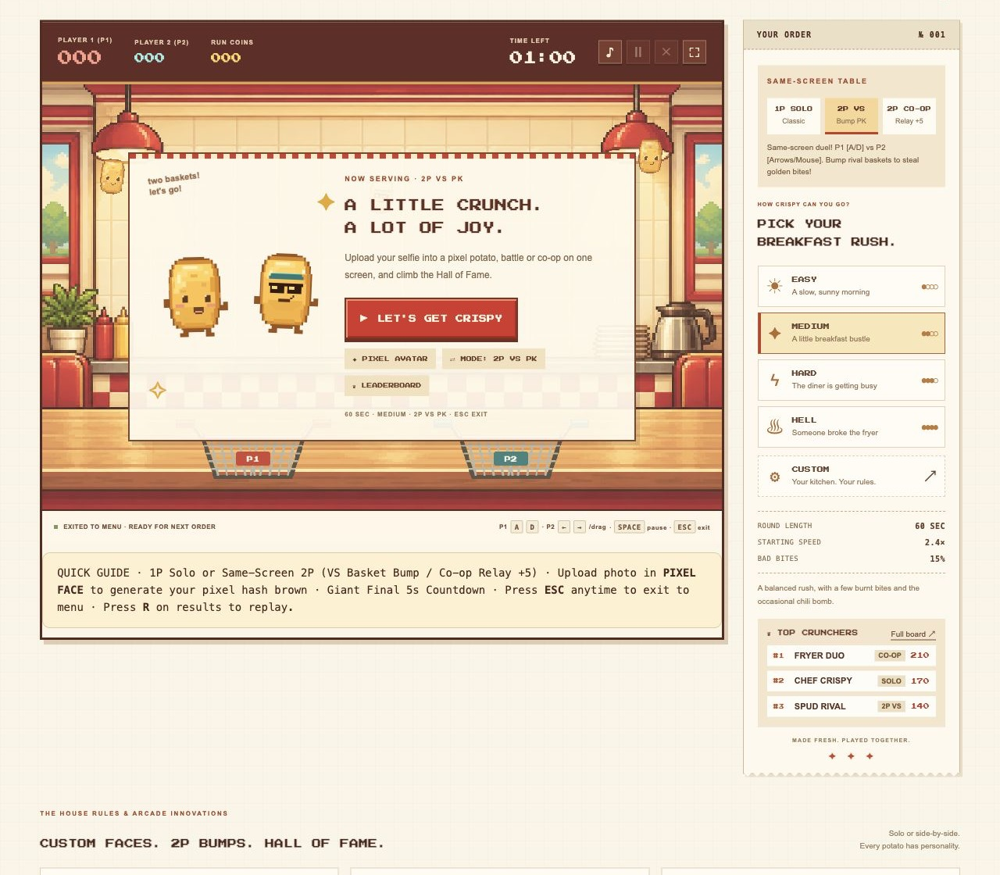
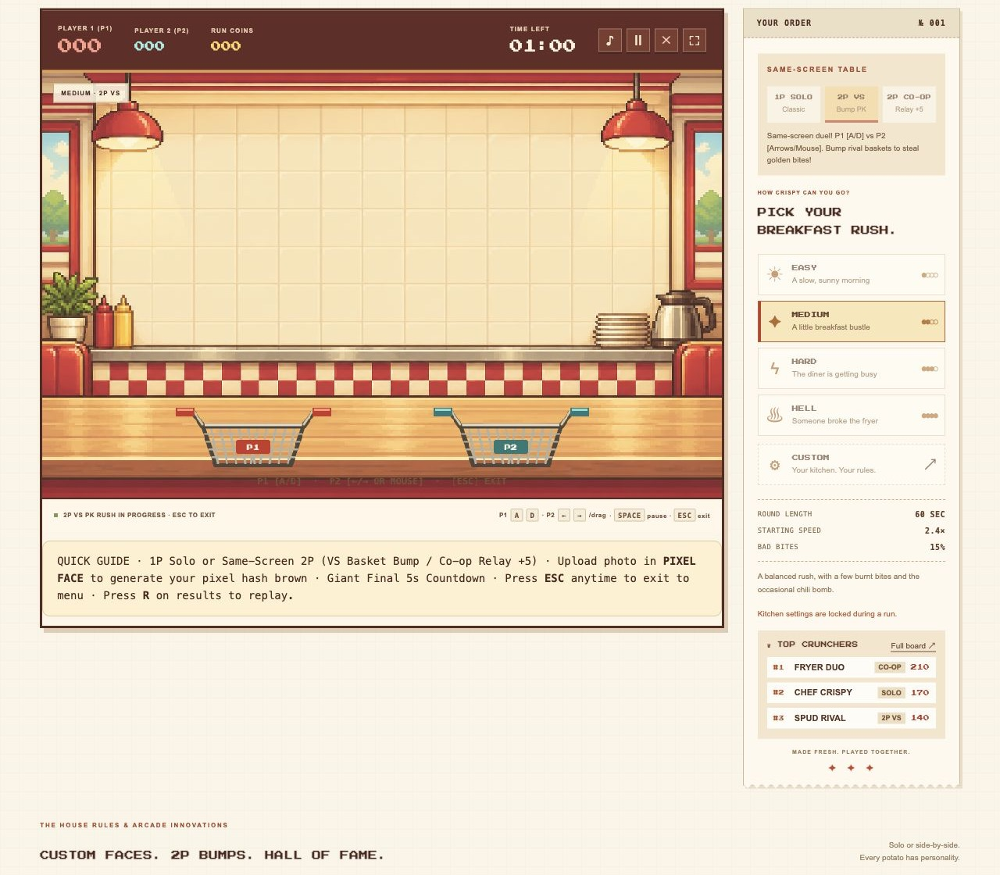
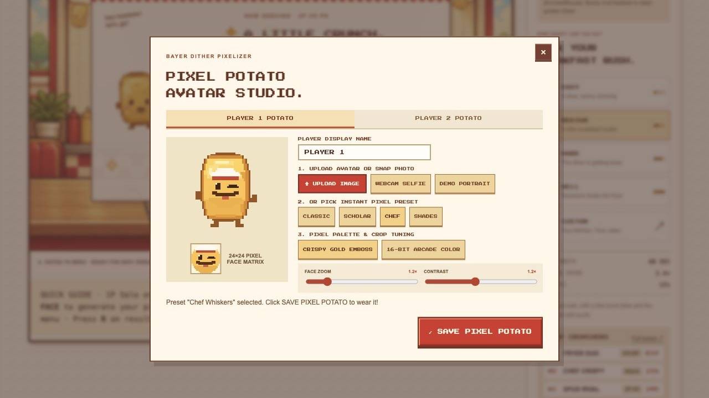

# Hash Brown Catch — Crunch Club

A pixel-art breakfast arcade: catch golden hash browns, dodge burnt bites and bombs, and customize your potato.

**[▶ PLAY ONLINE](https://sd5913.github.io/Hash-Brown-Catch/game/)** · **[PROJECT RECORD](docs/project-record.md)** · [Team board](https://github.com/orgs/sd5913/projects/6)

## The game

Solo or same-screen VS/co-op, adjustable difficulty, permanent local coins, a starter cosmetic shop, pixel avatars and a local Hall of Fame.

- Move with mouse/touch, arrows or A/D. Space/P pauses; ESC exits; R replays from results.
- Golden catch: +10 score and +2 coins. Miss: -2; burnt catch: -10; bomb: -20. Score never drops below zero.
- Two-player: P1 uses A/D; P2 uses arrows or mouse. VS includes basket bumps; alternating co-op catches earn +5 relay score.
- Saves and rankings stay in the current browser. House targets are demo benchmarks.

Current build: prepared for the **19 November review**, imported and published on **16 November 2026**. A reported skin purchase/equip problem remains open; see the project record.

## Screenshots

Screens captured from the current review build on 16 November 2026.

### Breakfast arcade

The diner interface, game menu and difficulty selection.

### Same-screen multiplayer

Two players share one screen, with separate baskets and score displays.

### Pixel Avatar Studio

Character presets, pixel preview and palette controls for personalized potatoes.

### Top Potato Leaderboard

Watch the players on the ranking list

### Promotion mode

Choose the promotion mode and challenge to enter high-end restaurants from street stalls.

### Switch to new scenes

Buy a new background with the points obtained from the game

## Team and development

| Member | GitHub | Focus |
| --- | --- | --- |
| CHEN Yueru (Crystal) | [@Crystalll0](https://github.com/Crystalll0) | Visual direction, prototype and coordination |
| MA Qianran (Renna) | [@maqianran](https://github.com/maqianran) | Internal testing and player feedback |
| LI Jiarui (Sherry) | [@SherryLi919](https://github.com/SherryLi919) | Game concept and interaction exploration |

**[Read the project record](docs/project-record.md)** for the dated timeline, design decisions, team contributions, feedback, review snapshots, known issues and next steps, all on one page. AI assisted with code implementation; team roles are documented separately from commit authorship.

## Run locally

Download and extract [the repository ZIP](https://github.com/sd5913/Hash-Brown-Catch/archive/refs/heads/main.zip). In the repository root:

- macOS/Linux: `python3 Launch-Game.py`
- Windows: `py -3 Launch-Game.py`

Python 3 and a modern browser are required. Keep the terminal open; Ctrl+C stops the server. Do not open the HTML with file://. All runtime assets are bundled; no npm installation or API key is needed.

## Repository guide

| Location | Purpose |
| --- | --- |
| `game/` | Playable game, source, assets and rule-check scripts |
| `docs/project-record.md` | Consolidated development and assessment record |
| `docs/credits.md` | Asset sources, AI assistance and licenses |
| `docs/tests/` | Automated check results |
| `docs/import-manifest.json` | Original source-import provenance |
| Root launch files and `index.html` | Local startup and online entry |

Optional checks: from `game/`, run `node check-stage.cjs`, `node check-rules.cjs` and `node check-innovations.cjs`. See [recorded output](docs/tests/automated-results.txt) and [credits](docs/credits.md).

Final course deadline: **6 December 2026, 23:59 HKT**.
